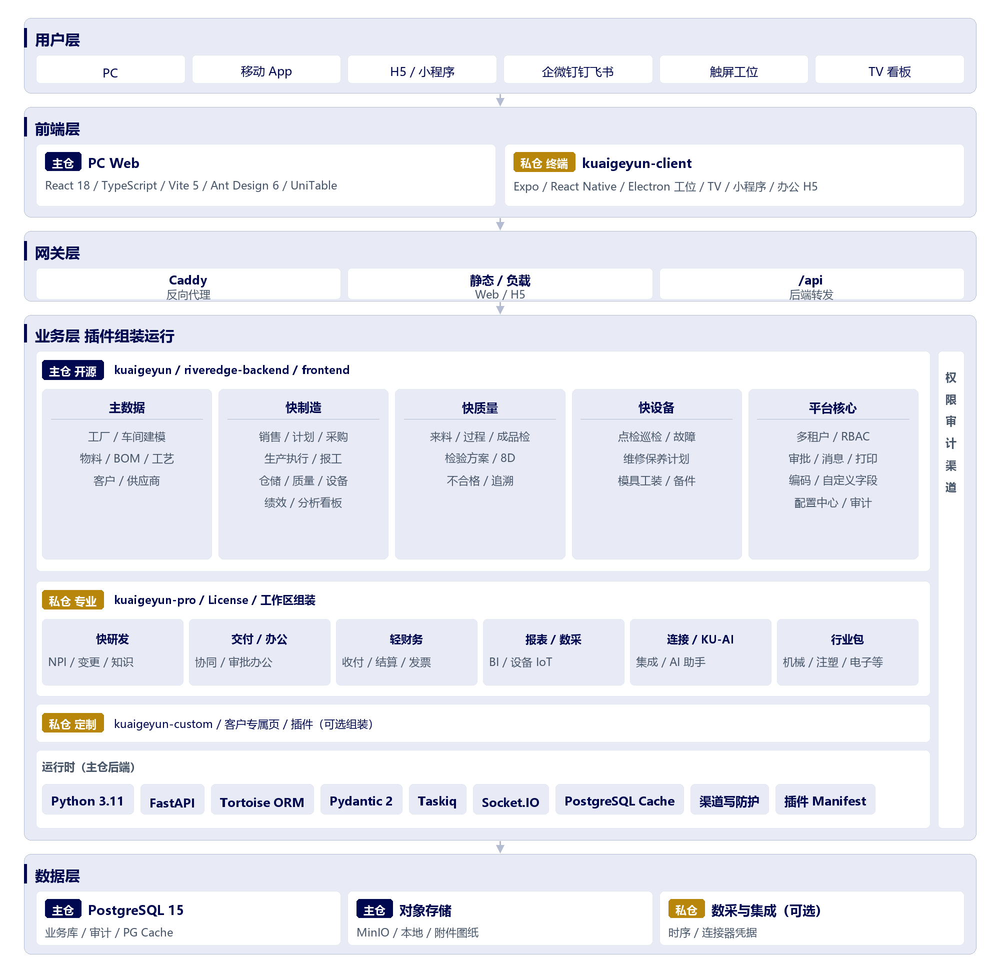

#  星技谷制造


---

## 15 秒了解星技谷制造

为离散制造企业打造的轻量级 MES：以统一需求模型贯通「销售-研发-计划-执行-质量-设备-仓储」，帮助企业在可控成本下快速上线并持续扩展。

**一句话价值**：用一套可渐进实施的制造系统，替代 Excel + 纸单 + 多系统割裂流程。

**适合谁**

- 10–200 人离散制造企业
- 多品种小批量，按单/按库混合生产
- 需要先跑通核心执行，再逐步扩展全流程协同

**你将获得**

- **更快上线**：插件按需启用，先跑通执行再扩展全流程，降低首期投入
- **更稳交付**：销售预测/订单进入统一需求，贯通计划、工单、采购与出入库，减少断点与交期偏差
- **更控质量**：来料到出货检验与追溯闭环，异常可定位、可复盘
- **更轻运维**：流程开关、自定义字段、打印与报表内建；默认 PostgreSQL + Taskiq，**无需 Redis**
- **更可追溯**：需求到执行全链路留痕，便于核对与复盘

---

## 立即体验与接入

- **在线演示**：[https://kuaigeyun.com](https://kuaigeyun.com)（建议使用 Gitee 快捷登录；数据可能定期重置）
- **部署入口**：[fast-deploy/deploy.sh](fast-deploy/README.md)（Windows / Linux）
- **完整文档**：[docs/部署指南.md](docs/部署指南.md)

> [!WARNING]
> **仓库范围**：本仓库包含 **后端 API**、**PC Web**（`riveredge-backend` + `riveredge-frontend`）、**移动端**（`kuaigeyun-client/riveredge-app-mobile`，uni-app x 蒸汽模式，同一工程出 Android、iOS、H5、微信小程序）与 **工位壳**（`kuaigeyun-client/riveredge-app-station`，Electron 44）。TV 看板客户端不在本仓。
>
> 星技谷制造仍在**积极开发中**，功能、数据模型与界面可能频繁变更；在线演示与本地部署**仅供预览与评估**，请勿用于正式生产或承载真实业务数据。
>
> **安装与升级**请在独立空白服务器或虚拟机中验证，避免与既有系统端口、数据库或配置冲突；**勿**在已承载生产业务的服务器上直接试装。若必须在生产环境部署，**须先完整备份**，否则可能导致数据不可恢复。

### 微信沟通反馈群


扫码加入 **快格云 MES 交流群**，反馈问题与建议。

> [!CAUTION]
> **渠道甄别**：版权方**未**在小红书、闲鱼等第三方平台销售或授权所谓「官方版」。若出现以 快格云 /快格云制造** 名义的 MES 收费推广，或暗示与本项目有关，**均非版权方提供或背书**。
>
> 本仓库开源部分采用 Apache 2.0，他人在**保留版权与 LICENSE、不冒用商标**等前提下可合规再分发（含有偿服务），但这**不代表官方渠道**。付费前请核实销售主体、交付物与开源声明是否完整，谨防冒充官方或夸大私仓未开源能力。

---

## 核心能力

业务覆盖 **星制造** 全流程，并与 **主数据**、**星财务**、**星研发** 等插件协同。

| 业务域     | 能力要点                                         |
| ------- | -------------------------------------------- |
| 销售与 CRM | 客户池、报价/跟进/合同、预测、订单与变更、发货/退货、销售看板             |
| 计划与排程   | 统一需求、需求计算（BOM/净需求）、变更、排程/甘特、缺料预警             |
| 采购协同    | 申请/询价、订单与变更、到货/退货、采购执行与报表                    |
| 生产执行    | 工单、报工、返工、委外、装箱、异常闭环；工位/移动端执行                 |
| 质量与追溯   | 来料/过程/成品/OQC、检验方案、8D、SPC、不合格与全链路追溯           |
| 仓储物流    | 入出库、批次/序列号、盘点/调拨、组装拆卸、线边仓/倒冲、库存预警            |
| 设备与资材   | 点检/巡检/故障/维修/保养；模具工装借还、维保、校准与备件               |
| 绩效      | 班次排班、工作日历、技能/计件/KPI                          |
| 财务（星财务） | 应收应付、收付款、发票、对账、成本与总账                         |
| 主档与研发   | 工厂/物料/BOM/工艺/图纸/SOP；NPI 阶段门、变更、FMEA（主数据/星研发） |

### 系统架构

<p align="center">
  
</p>

主仓开源核心与私仓（专业版 / 终端 / 定制）以色标区分；私仓经工作区组装或部署向导链入后一体运行。

**平台（本仓库开源）**：多租户与 RBAC、插件装配、配置中心、审批与消息、编码与自定义字段、打印与连接器、内置看板报表、上线检查与审计。高级分析 / AI / 数采见下方高级版插件。

---

## 插件应用

插件按需装配。**开源版**随本仓库发布；**高级版 / 行业付费版**在私仓 `[kuaigeyun-pro](https://gitee.com/kuaigeyun/kuaigeyun-pro)`，经 `./fast-deploy/deploy.sh pro-apps` 或部署向导 **[4] 扩展应用** 安装。应用中心仅展示已扫描入库的实装应用。

| 分层       | 插件 / 包        | 说明                                                               |     |
| -------- | ------------- | ---------------------------------------------------------------- | --- |
| **开源**   | 星制造           | 销售、计划、采购、执行、质量、设备、仓储、分析、绩效                                       |     |
| **开源**   | 主数据           | 工厂建模、物料/BOM/工艺、客户/供应商                                            |     |
| **开源**   | 星财务           | 应收应付、发票、成本、总账                                                    |     |
| **开源**   | 星研发           | 研发项目 / NPI、设计变更、知识中心                                             |     |
| **行业免费** | 本仓库行业包        | 无需 License；示例：辐条轮毂总装（[@xyt123lyq](https://github.com/xyt123lyq)） |     |
| **行业付费** | kuaigeyun-pro | 需 License；机械加工、注塑、电子、汽配等增值包                                      |     |
| **高级版**  | 星AI           | 顶栏助手、单据问答、知识库 RAG                                                |     |
| **高级版**  | 星报表           | 报表设计、BI 看板、多源聚合                                                  |     |
| **高级版**  | 星数采           | 工业设备数采与集成（持续迭代）                                                  |     |


---

## 终端形态

同一套后端 API 与业务模型，按岗位与现场组合部署。本仓库包含 **PC Web、后端 API、移动端**（`kuaigeyun-client/riveredge-app-mobile`，uni-app x）与 **工位壳**（`kuaigeyun-client/riveredge-app-station`）；TV 看板客户端不在本仓。

| 终端               | 技术栈                                                  | 源码                                                            | 典型场景                  |
| ---------------- | ---------------------------------------------------- | ------------------------------------------------------------- | --------------------- |
| **PC Web**       | React 18 + TS 5 + Vite 5 + Ant Design 6              | 本仓库 `riveredge-frontend`                                      | 计划、主数据、销售/采购/财务、审批、报表 |
| **后端 API**       | FastAPI + Tortoise + PostgreSQL 15 + Taskiq          | 本仓库 `riveredge-backend`                                       | 全终端共用业务与权限            |
| **移动 App**       | uni-app x 蒸汽模式（Android / iOS）                        | 本仓库 `kuaigeyun-client/riveredge-app-mobile`                   | 工业 PDA 扫码、移动报工、收发货、巡检 |
| **H5 / 小程序**     | 同一套 uni-app x；H5 经 Caddy `/mobile`；微信小程序 `mp-weixin` | 本仓库（同上）                                                       | 轻量访问、iOS 过渡、外协/访客     |
| **企微 / 钉钉 / 飞书** | 办公平台内嵌 H5 + OAuth / JS-SDK                           | 本仓库 `kuaigeyun-client/riveredge-app-mobile/shared/channel/h5` | 待办审批、消息触达、移动审单与扫码     |
| **触屏工位**         | Windows + Electron 44；薄壳加载服务器工位入口                    | 本仓库 `kuaigeyun-client/riveredge-app-station`                  | 固定工位过站、戴手套触屏、可选刷脸共享   |
| **TV 看板**        | —                                                    | —                                                             | 本仓未包含该客户端             |


**选型建议**：办公室计划/物控 → PC；仓库 PDA / 无微信现场 → App；已用企微钉钉飞书 → 办公 H5；产线固定工序 → 触屏工位；班组巡视 → TV 看板。

部署默认 Caddy 反向代理（Web `/`、H5 `/mobile`、API `/api`）。移动端发行与 H5 路径见 [kuaigeyun-client/riveredge-app-mobile/README.md](kuaigeyun-client/riveredge-app-mobile/README.md)、[RELEASE.md](kuaigeyun-client/riveredge-app-mobile/RELEASE.md)；H5 / 企微配置见 [docs/部署指南.md](docs/部署指南.md)；第三方许可见 [NOTICE](NOTICE)。

> **源码说明**：本仓库含 **PC Web、后端 API、移动端**（uni-app x：Android / iOS / H5 / 微信小程序，含企微 / 钉钉 / 飞书的 H5 接入）与 **工位壳**。TV 看板客户端不在本仓。安装包与 H5 静态资源由 HBuilderX 发行或部署脚本复制，不在本仓提交构建产物。

---

## 快速开始

环境要求：Node.js 22+、Python 3.11（`uv.lock` 锁定 `==3.11.*`，工程要求 `>=3.11,<3.12`）、PostgreSQL 15+、Caddy（生产）；默认无需 Redis。移动端用 HBuilderX 发行，不经 npm 编译。

```bash
# Gitee（国内推荐）
git clone https://gitee.com/kuaigeyun/kuaigeyun.git
# GitHub
git clone https://github.com/kuaigeyun/kuaigeyun-mes.git
cd kuaigeyun   # 或 kuaigeyun-mes，取决于 clone 目录名

./fast-deploy/deploy.sh       # 生产模式（8 阶段向导）
./fast-deploy/deploy.sh dev   # 开发模式（Vite 热重载）
```


| 模式  | Web                   | API                   |
| --- | --------------------- | --------------------- |
| 生产  | `http://<服务器IP>:8080` | `/api`（经 Caddy 转发）    |
| 开发  | `http://<服务器IP>:8100` | `http://<服务器IP>:8200` |


- 部署文档：[docs/部署指南.md](docs/部署指南.md)（含**开发预览**与**备份**警告）
- 脚本速查：[fast-deploy/README.md](fast-deploy/README.md)

---

## 推荐配置

单机部署（PostgreSQL 与后端、Taskiq、Caddy 同机）时的硬件参考；详细说明见 [docs/部署指南.md](docs/部署指南.md#硬件建议)。


| 档位       | 适用场景                 | CPU  | 内存    | 磁盘                       |
| -------- | -------------------- | ---- | ----- | ------------------------ |
| **最低配置** | 开发调试、POC 试用、≤10 并发用户 | 2 核+ | 4 GB+ | 20 GB+（系统 + 库 + 日志）      |
| **推荐配置** | 中小团队生产、日常业务与报表       | 4 核+ | 8 GB+ | 50 GB+ SSD（含数据库、附件与日志余量） |


**软件环境（与快速开始一致）**：Node.js 22+、Python 3.11（运行时由 uv 锁定 3.11）、PostgreSQL 15+；生产模式需 Caddy。**不需要 Redis。**

> 内存 ≤2 GB 的云主机易在 Taskiq 启动阶段因 swap 变慢，部署脚本可自动创建 swap；更稳妥请按**推荐配置**或启用 [低配模式](fast-deploy/README.md) 说明。

---

## 文档导航

- [README](README.md)：产品定位、核心能力、插件与终端、快速启动、推荐配置
- [docs/部署指南.md](docs/部署指南.md)：环境准备、发布流程、运维排查
- [fast-deploy/README.md](fast-deploy/README.md)：部署脚本参数与速查

---

## 联系方式

- 官网：[https://kuaigeyun.com](https://kuaigeyun.com)
- 反馈：Issue 或内部渠道
- 邮箱：[ludingjie@live.cn](mailto:ludingjie@live.cn)
- 微信：`lu_dingjie`

---

## 支持我们

星技谷制造持续开源迭代，离不开社区关注与支持。若项目对你有帮助，欢迎：

- 在 [Gitee](https://gitee.com/kuaigeyun/kuaigeyun) / [GitHub](https://github.com/kuaigeyun/kuaigeyun-mes) 给仓库点一颗 **Star**，方便更多制造同行发现
- 关注更新、提交 Issue / PR，一起把产品打磨得更好
- 有条件时通过捐赠支持持续维护（鸣谢名单见下）

> 你的每一个 Star，都是我们继续更新的动力。

### 捐赠鸣谢

感谢以下朋友对项目的支持（按捐赠时间先后排列）：


| 捐赠人     | 金额（元） |
| ------- | ----- |
| lvlijun | 500   |
| Mike猫空  | 66    |


如需出现在名单中，可通过微信 `lu_dingjie` 或邮箱 [ludingjie@live.cn](mailto:ludingjie@live.cn) 联系，并备注展示名称。名单将不定期更新。

---

## 上游同步台账（私有分叉维护）

> 本节为本 fork 的维护记录，非上游产品文档。用途：下次同步时快速定位「已评到哪个上游提交、哪些已取/已跳过」。

**同步策略**：上游（Gitee/GitHub 开源仓）做底座，本地 `kuaiiot`/星数采等重建功能叠加其上。只摘取有价值且不影响现有功能的变更；上游放在 pro 仓、OSS 缺失的后端按前端契约+迁移 DDL 本地重建（同 kuaiiot 还原模式）。红线：不删现有功能、不并立两套同功能实现、保住租户隔离/权限/审核门控/MES 回写语义。

**远端与水位**

- `gitee` = `git@gitee.com:kuaigeyun/kuaigeyun.git`（上游主源）；`upstream` = GitHub 镜像；`origin` = 本私有 fork
- **已评估到的上游 tip：`91b95d2ada`**（gitee/develop，新链 tip 为 dist 提交，最后业务提交 `9ffd857453`/`a9bf3a6e2f` merge）。该提交及更早的全部上游提交均已逐一评估（取/适配/跳过）
- ⚠️ **上游曾 force-push 重写历史**（oss-pro 解耦 + dist 历史剥离，`7808de234d→ffe8ffd7fa`）：2026-10-13 之前批次的旧上游哈希在新链上已全部失效，下表旧批哈希仅为历史记录锚点；新链上以内容对应（`001af8dc75` ≈ 旧 `56d484fdf8`）
- 下次同步：`git fetch gitee && git log --oneline a9bf3a6e2f..gitee/develop`（业务提交口径），范围内即未评新提交

**已同步映射（上游 → 本地，2026-10-15 新链批次）**

| 上游提交 | 本地提交 | 方式 | 内容与备注 |
| --- | --- | --- | --- |
| `a0ea4efd00` `656e38eb95` `0fc8362431` `d05ceb48ad` | `c8b7739ae6` `10c44a470e` `bbbfcb9a3f` `9d5dbb18d9` | 摘取 | 单位治理 4 连击：失效生产单位映射裁撤、工单计划数量跟基础单位、单位名称为真源、单位快照回填；迁移重映射 |
| `978a1fb9e5` | `798229b9ef` | 摘取 | 保养/点检方案参数与任务落库、租户初始化引导；迁移重映射 874/875 |
| `66bea0e68c` | `fc25cc3bf0` | 摘取 | 造数同步操作日志、全有或全无落库 |
| `a0787316f3` | `2570bd6627` | 摘取 | 盘点列表取数参数误用未定义变量 |
| `40599c81ed` | `551a68e18e` | 摘取+本地化 | kuaiai 能力矩阵提速（`_audit_bundle`+gather+Pulse TTL）；保留 `to_site_date` 分桶与 `Optional[int]` Pulse 语义 |
| `c16a17ebba` | `167481a393` | 摘取 | 系统架构图 + 禁止间隔号规则（纯文档） |
| `2bd59d411f` | `d4991eef70` | 摘取+适配 | 图档发放借阅、业务附件鉴权、工程图纸图档格式；迁移重映射 |
| `8597d7a461` | `bdb64b09f9` | 摘取+适配 | 销售订单字段脱敏、交付物体系清单迁移；剥离 kuaiplm(pro) 内容 |
| `3e128b1459` | `57f8389c81` | 摘取 | UniImport 失败原因汇总、菜单分组、导入/项目建议书配套；剔除 funide_oa(pro) 测试 |
| `6b3722a9ab` | `da374cfba4` | 摘取 | 审批提交增强（发起人自选审批人）、付款申请上拉、杂项财务前端 |
| `7ba631a5f0` `23bc264280` `88d46269e4` `0b2fb040e9` | `8ab7281391` `6fe3d3f4cd` `79887ff4c0` `72c47d6dff` | 摘取 | 菜单链 4 修：接管只认启用应用、同步只认磁盘 manifest、财务接管 canonical 来源、scan/sync-all 物化 |
| `073902612c` `2bde760cab` `4409dcbd5d` | `19b96aac8a` `a08eaf1447` `ab8461510f` | 摘取 | 审核按钮门禁 3 修：当前待审保留按钮、hub 不被过期列表门阻断、提示对齐当前节点 |
| `2377282bd8` | —— | **跳过（决策B）** | 上游 OSS 版其他收支挂 `kuaizhizao`——与本地 `kuaicaiwu` 重建版同功能双实现，不取 impl，只移植后续修复 |
| `3e42e979d0` `84dd5d74ac` `6a308850dc` `de8009abf0` | `b6192a882e` `07a033a6e2` `07b6885ac4` `3d55a4e25f` | 摘取 | 分支条件审批链 4 修：前节点先决策、批准显式选边+AR/AP 回写、保留选边显示未来待办、条件路由选边人/弹窗 UX |
| `ef73ad9afe` | `fbe1795be7` | 摘取+适配 | CRM 公海 crm scope、收款单、应用中心提速；合并 workspace PRO_APPS 目录与本地 report/AI 生命周期 seeding |
| `d8d297794c` `98cfb42b0c` `af81d592c3` | `350a1f1556` | **移植到 kuaicaiwu** | 其他收支三连修复（行保存 AttributeError、发起人快照、自选审批人弹窗）——按决策B适配到本地 `MiscVoucherService` 架构 |
| `455137c39c` | `deeadd7aca` | 摘取+适配 | 流程造数增强 + 租户恢复悬空部门外键置空；`force_simple_when_unset` 与本地 `default_none` 语义合并 |
| `f55fe1a6a1` | `82b3404046` | 摘取（决策A） | **下线点检计划模块**跟随上游；迁移 `887_drop_equipment_spot_check_plans`；剔除 kuaiiot-device-trend-chart 日志条目（本地为重建版） |
| `6a40c12117` | `5d8465af09` | 摘取 | RBAC：取单来源回显即可不必开查看 |
| `af81d592c3` | （见上 350a1f1556） | 移植 | — |
| `d9b02748d5` | `4cbc5b0777` | 摘取 | 补料领料同步、保养要求展示、其他入库编辑 |
| `9ffd857453` | `1678ae4b1f` | 摘取 | 销售订单明细物料显示、工单出库报价列表性能 |
| `304c2884f8` | —— | 跳过 | funide-oa 研发交付物文案（客户专属应用，无通用代码落点） |

**已同步映射（上游 → 本地，2026-10 早期批次，旧链哈希）**

| 上游提交 | 本地提交 | 方式 | 内容与备注 |
| --- | --- | --- | --- |
| `4fcecb1987` | `5f48a9e8ee` | 摘取 | 备份定时任务全局锁、Gitee OAuth state 签名、远程删除失败关闭 |
| `5afa59d5bc` | `a5c803750f` | 摘取 | 采购申请审核权限前缀 `purchase-request`→`purchase-requisition` |
| `8640dc6747` | `86e2cd8069` | 摘取+适配 | 设备点检计划/方案绑定；迁移重映射 859/860 |
| `fad5c06716` | `b006f69253` | 摘取+适配 | 委外检验 + 质量巡检；迁移→861/862；10 处冲突逐个解决 |
| `99ce86ec13` | `d2131f34a5` | 摘取+适配 | 图纸气泡标注 + 计划质检修复；BasicLayout 只移植 `meta.is_pro` 徽标分支 |
| （批次适配） | `d24170f8cd` | 本地补 | kuaiiot `schedule_device_update` 实时事件发布端（上游在 pro）；`collapse_material_rows_to_unique_units` 移植；`quality_fai` Body import；测试桩 |
| `bcc4a735a5` | `56ea63a289` | 摘取+重建 | 财务包：付款申请、客商多账户直接落地；**其他收支后端系 pro 侧，已按契约本地重建**（`kuaicaiwu`：other_voucher/finance_misc_category 模型、misc_voucher_* 服务、3 组 API、QS/QZ 编码）；迁移→864–873 |
| `e249516c6c` | `5c3b124c2b` | 摘取+适配 | 金蝶预置/供应商同步进度；`approval_viewer_actions` 门控底座；付款申请 pull 端点 |
| `ab3cc22e5e` | `694893c95d` | 摘取 | 审核三端统一 `viewer_actions` 门控（`audit_flow_viewer_gate`+`audit_record_enricher`）；审批状态精确查实例 |
| `2d72a1f181` | `bce5df3894` | 摘取 | `get_approval_status` UnboundLocalError→500 修复 |
| `fcf571bbc4` | `c772f1f3ac` | 摘取 | 配置中心 `sectionKey`、菜单同步联动刷新、审批节点总览；**行为变更：停发拆分交付计划站内提醒** |
| `56d484fdf8` | `5328598368` | 摘取 | 生产领料创建即启审、工单单位缓存、销售合同 hooks 顺序 |
| `7af3b0c7e9` | `f24d3db7f6` | **手工复刻** | 性能：三单据详情 gather、生命周期里程碑→业务事实、trace 引擎缓存/并行/批量删除标记、附件中心并行、前端物料按需缓存 + `useDeferAfterPaint`、InfluxDB 实测连通 |

**明确跳过 / 剔除（勿重复评估）**

- `2377282bd8` 上游 OSS 版其他收支（`kuaizhizao` impl）——决策B保本地 `kuaicaiwu` 重建版，后续修复以移植方式进入
- `304c2884f8` funide-oa 研发交付物文案——客户专属应用
- `9e7bc7fc9d` 侧边栏重构——与本地 BasicLayout 路线冲突，只取了 `meta.is_pro` 徽标分支
- 上游 pro 侧代码（OSS 无对应文件）：其他收支后端（已本地重建）、kuaiai 设置页去 OCR/WorkBuddy、kuaiiot-command-device-id 迁移——对应 updateLog 条目均已剔除
- `cd30a1c98` kuaiiot realtime：通道/前端早前已取；发布端在 pro，已由 `d24170f8cd` 本地补 `schedule_device_update`
- 更新日志条目凡代码在 pro 或未摘取者一律剔除，不虚报

**维护约定**

- 迁移号避让：上游占用段一律重映射到本地连续段（当前已到 887），不改已入库 aerich 记录的文件名
- 每批摘取后：`uv run pytest`（后端全量）+ `npm run build`（前端）；dist 单独 `chore: build-web sync` 提交
- spec-143 裸查：新代码禁无 `tenant_id` 的租户表查询；`import_pro_*` 全仓清零，遇上游新增一律转本地直接 import
- AOCI：`aoci maintain` CLI 目前无法写正式卷（blocked 存量态），提交照常、如实记录

---

## 许可证

见 [LICENSE](LICENSE)。
