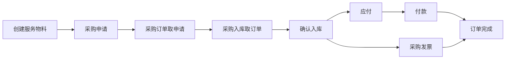

# 服务采购做单说明

服务采购用于维修、费用、劳务等不入库的采购。推荐按下面顺序做单，单据之间用取单衔接，采购类型和数量、含税单价会沿来源单带下来。

采购申请审核通过后，在采购订单里取这张申请。采购订单审核通过后，在采购入库里取这张订单。确认入库后按立账策略生成应付，不写入库存，也不外推金蝶。

## 1. 创建服务类物料

路径：基础资料，物料管理，新建物料。

| 字段 | 怎么填 |
| --- | --- |
| 来源类型 | 服务 |
| 基本单位 | 按实际计量填，例如次、项 |
| 存货类别 | 可以不填。要填时只选服务、费用、劳务 |
| 采购单价 | 有固定采购价时填写，申请选料后会带到建议单价 |

不要把存货类别填成原材料、辅料、半成品、产成品、商品或资产。来源类型不是服务、存货类别又空着的物料，也不能用于服务采购。

服务采购的申请、订单、入库，物料下拉和批量选择只列出来源类型为服务的物料。

## 2. 新建采购申请

路径：采购管理，采购申请，新建采购申请。

1. 采购类型选服务采购。它和标准采购、资产采购互斥，三张下游单据都沿用这一类型。
2. 填写申请人、申请日期。
3. 明细选择上一步的服务物料。主数量默认 1，单位用物料的基本单位。建议单价按含税填写。
4. 保存后提交审核。审核通过、状态为已通过、已审核或已确认后，才能被采购订单取单。已部分转单、仍有剩余数量的申请也可以继续取。

申请上的建议单价是含税单价。取到采购订单后，含税单价与申请一致，系统再按税率拆出未税金额和税额。

## 3. 采购订单取单采购申请

这是申请进入订单的推荐做法。

路径：采购管理，采购订单，从采购申请创建采购订单。

1. 在取单窗口选已审核且仍有剩余数量的服务采购申请。
2. 核对采购类型为服务采购，物料、主数量、含税单价、税率与申请一致。
3. 补供应商。供应商若维护了立账策略、付款方式、币种，会带到订单。
4. 保存并提交审核。

申请行被订单占用后，申请变为部分转单或全部转单。一张申请的数量取完后，不能再被另一张订单重复取走。

## 4. 采购入库取单采购订单

这是订单进入入库的推荐做法。服务采购用入库单确认履约并作为立账依据，不表示货物入仓。

路径：仓储管理，采购入库，从采购订单创建采购入库单。

1. 在取单窗口选已审核、仍有未入库数量的服务采购订单。
2. 采购类型、供应商、物料、含税单价、税率、立账策略从订单带入。入库数量不超过未入库数量。
3. 仓库、库位、批号可以留空。不需要为服务采购建虚拟仓库。
4. 保存入库单。标准采购和资产采购仍然必须选择仓库。

## 5. 确认入库与立账

在采购入库单上执行确认入库。

确认之后系统会：

- 回写采购订单的已收数量
- 按该单的立账策略决定是否生成应付
- 不增加库存，不扣库存，不要求批号和序列号

服务采购确认入库不外推金蝶。已保存的服务采购订单、入库单也不会进入金蝶外推或同步候选。

立账策略以单据上的值为准，取单时从订单带到入库单。四种策略如下。

| 立账策略 | 确认入库时 | 应付在何时产生 |
| --- | --- | --- |
| 以采购入库确认为准 | 自动生成应付 | 确认入库后 |
| 以采购发票为准 | 不生成应付 | 登记进项发票时 |
| 手工立账 | 不生成应付 | 在应付里手工生成 |
| 以按月结对账单为准 | 不生成应付 | 供应商对账单审核后 |

只确认入库并生成应付时，采购订单进入账款发票，还不算完成。

## 6. 发票、付款与完成

应付生成后，按付款申请、付款核销把应付付清。进项发票按订单或入库登记，发票金额覆盖订单含税金额。

采购订单同时满足下面两条时为已完成：

- 采购发票金额进度达到 100%
- 付款进度达到 100%

状态已经是已完成的订单，直接视为完成。只做了确认入库、只生成了应付、或只登记了发票，订单都停在账款发票。

采购申请在明细数量全部转到订单后为全部转单。入库单确认后为已入库。

## 和标准采购、资产采购的差别

| 项目       | 服务采购                   | 标准采购、资产采购 |
| -------- | ---------------------- | --------- |
| 物料       | 来源类型为服务，或存货类别为服务、费用、劳务 | 按各自类型限制物料 |
| 仓库、库位、批号 | 可以不填                   | 入库必须选仓库   |
| 确认入库     | 回写订单已收，按策略立账           | 同时过账库存    |
| 金蝶       | 不外推、不同步                | 按现有外推规则   |
| 做单顺序     | 订单取申请，入库取订单            | 同样推荐取单    |

